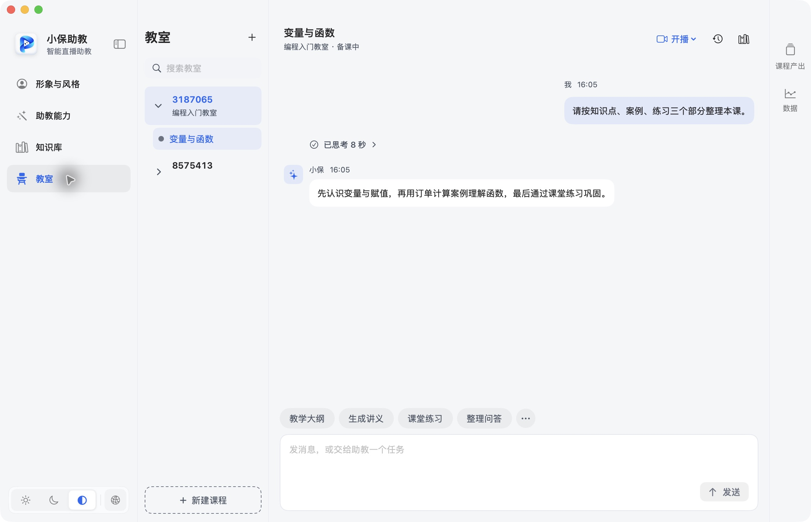
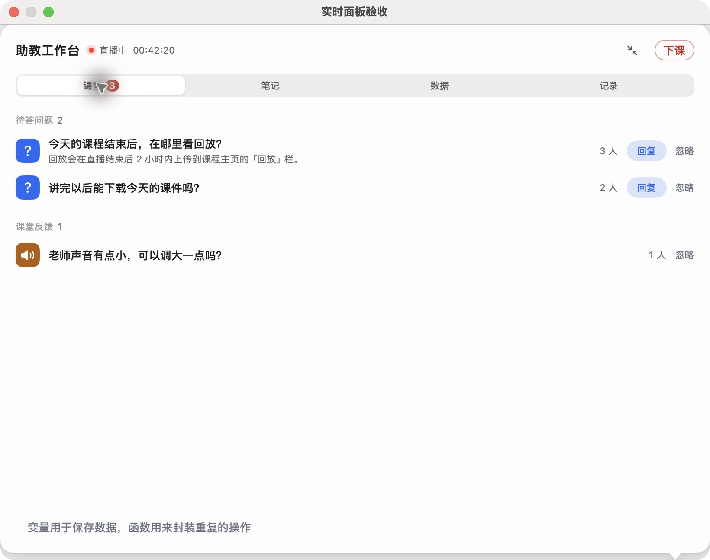
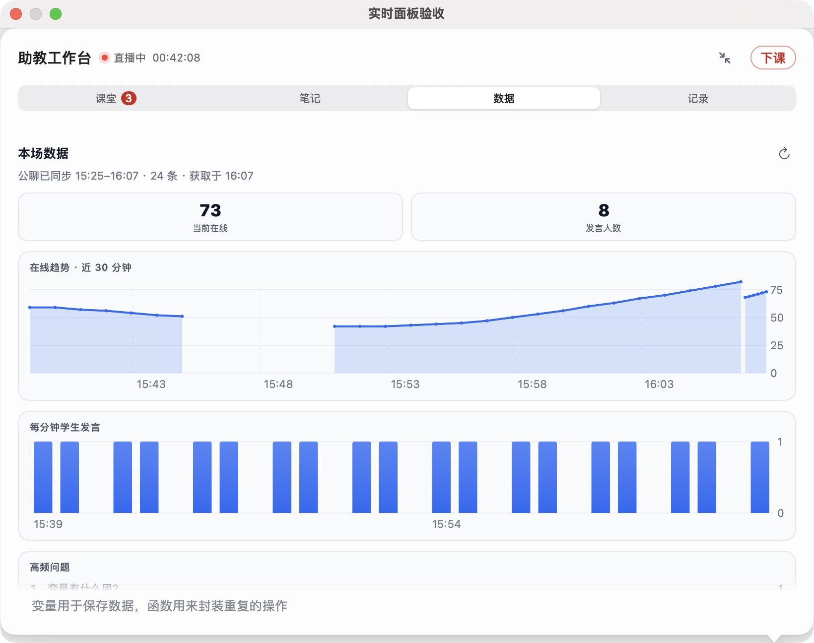
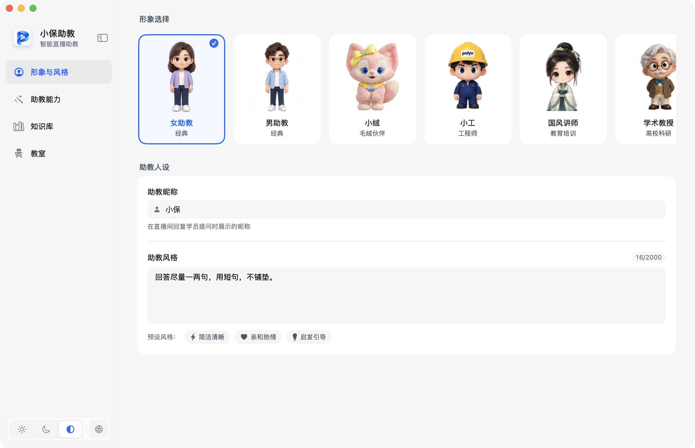

# 小保助教

**让主讲专注讲课，让助教照顾课堂。**

小保助教是一款围绕保利威直播的桌面端 AI 助教，将备课、课堂协助与课后复盘连接起来，让讲师更专注于教学。

## 核心能力

- **课前备课**：整理课程资料，生成大纲、讲义和练习题，建立本课知识依据。
- **课中协助**：接收课堂消息，结合课程资料答疑，通过语音或界面操作签到、公告和答题卡。
- **课后复盘**：汇集课堂问答、口播和互动记录，生成课程总结，将有价值的资料沉淀到知识库。

桌面助教提供轻量入口，工作台集中处理课堂事务，教室持续保存课程与资料。

## 界面预览

截图来自应用预览模式，内容为模拟数据。

| 课前备课 | 课堂工作台 |
| --- | --- |
|  |  |
| **课堂数据** | **助教形象与风格** |
|  |  |

## 保利威接入

- **官方互动 SDK**：使用 `@polyv/interactions-launch-sdk@0.7.0`，支持签到、公告、答题卡、问卷、抢答、计时器、卡片推送及抽奖等互动。
- **聊天室能力**：通过 Swift Socket.IO 接收消息、发送文字与文件，并执行课堂管理操作。
- **Open API**：用于频道校验、题库管理、课堂数据查询与开播入口。

## 下载与了解

- [下载最新安装包](https://github.com/pincc-debug/xiaobao-assistant/releases)
- [项目介绍](docs/competition/README.md)
- [技术与 SDK 调用说明](docs/competition/AI_REVIEW_GUIDE.md)
- [构建与运行](docs/competition/VERIFICATION.md)
