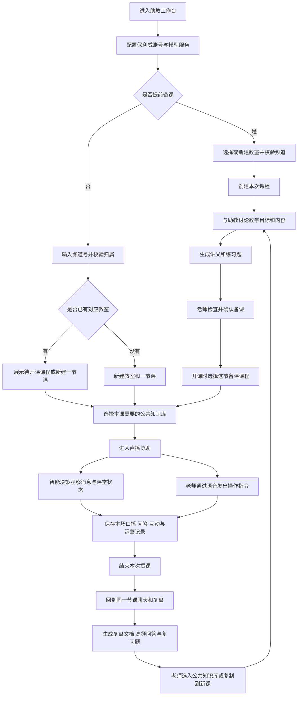
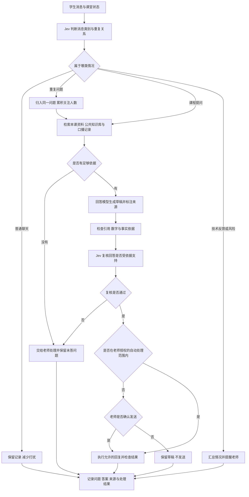
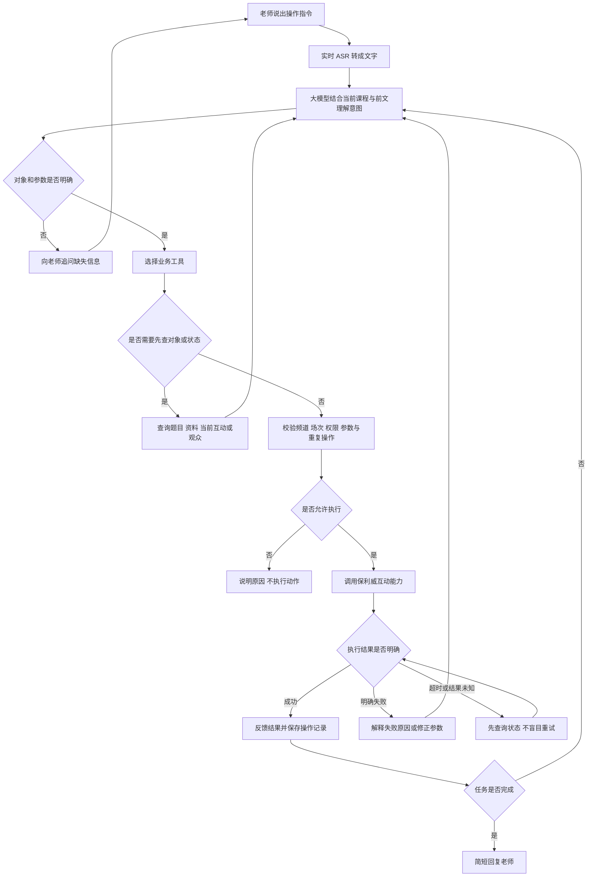
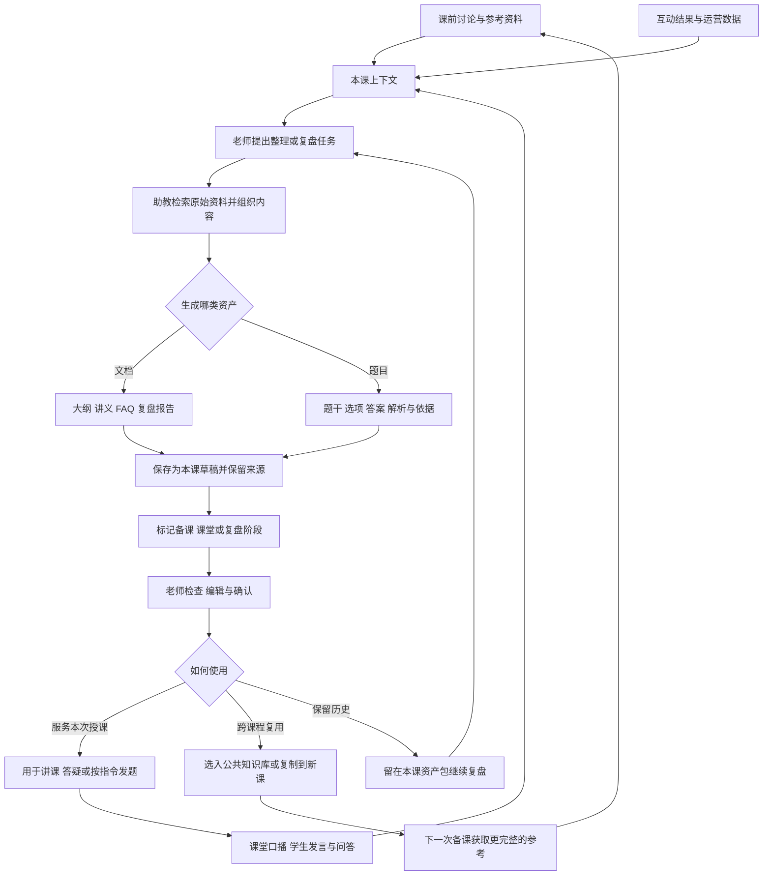

# 智能直播助教项目构想

我们想围绕保利威直播，做一个面向讲师的 AI 助教工作台。老师可以在同一个教室里备课、处理课堂事务和复盘。过程中产生的资料，可以留给下一次授课使用。

这个产品有两方面价值：

1. **资产持续沉淀**：让备课讨论、课堂互动和课后复盘形成课程资产。每次授课的经验，都能成为下一次备课的依据。
2. **减少老师的操作负担**：通过智能决策和语音手替两条能力线协作。让老师少盯消息、少找入口，减少维护直播间的动作。

以下按产品路径、能力分层和技术方案展开。模型与平台接入均作为候选方案讨论。

## 一 产品长什么样

产品可以围绕“教室—课程—资产”组织。

| 对象 | 对应关系 | 用来做什么 |
| --- | --- | --- |
| 教室 | 一个直播频道对应一个长期项目 | 聚合这个频道的课程、资料与历史讨论 |
| 课程 | 一节课对应一次授课会话 | 保存本课备课、聊天、课堂记录与复盘 |
| 本课资产 | 文档、结构化题目、课堂记录等 | 为本次授课提供依据，并支持课后回看 |
| 公共知识库 | 可跨课程复用的资料 | 提供课程安排、常见问题和通用知识 |

界面可以参考聊天软件：左侧选择教室和课程，中间与助教对话，右侧查看文档、题目、互动情况和运营图表。老师通过对话提出任务，也可以直接查看和使用资产。

一节课只对应一次开播。结束后仍可持续聊天、复盘；再次授课时，可以复制备课与资料到新课。这样不同场次的数据就不会混在一起。

## 二 用户使用路径

老师可以提前备课，也可以直接开播。两种入口最终都会落到一节独立课程，便于保存上下文与课后复盘。

关键体验约定：

- 新建教室时先填写必填频道号，再填写可选名称。
- 频道需要属于当前保利威账号，校验通过后才能继续。
- 开课可以选择已确认且未使用的备课课程，也可以新建课程。
- 已用于开播的课程不再出现在下次开课的可选列表中。
- 历史课程始终可以回看、聊天和复盘，不因“已使用”而关闭。

## 三 两条智能能力线

“智能决策”和“老师的手替”是两种工作方式。它们可以共用模型、课程上下文和工具，但触发方式与操作权限应当不同。

| 能力线 | 谁发起 | 重点解决的问题 | 典型输出 |
| --- | --- | --- | --- |
| 智能决策 | 课堂消息和状态变化 | 老师需要持续盯消息、识别问题、准备回应 | 合并问题、回答草稿、提醒、待处理事项 |
| 语音手替 | 老师的明确指令 | 老师需要查入口、选对象、填参数、点按钮 | 发起签到、发送题目、发布公告、查询结果 |

### 智能决策的流程

助教可以持续观察学生消息，结合本课资料与课堂上下文判断下一步。普通聊天不必打扰老师，重复问题可以合并，技术反馈和风险则需要适时提醒。

可以考虑的主动协助包括：

- 将同一诉求的多条提问合并，提醒老师集中回应。
- 为回放、课件、课程安排等问题检索并准备答案。
- 汇总“听不到”“卡顿”“看不清”等技术反馈。
- 标记广告、引流和明确辱骂等风险消息。
- 将老师的口头回应与学生问题关联，减少重复提醒。
- 按配置准备欢迎信息、阶段总结和课堂重点。

自动处理应按动作分别授权。整理和准备草稿可以更主动；对外回复、禁言、踢人等动作，需要更明确的规则。低置信度结果交给老师，不猜测、不冒充操作成功。

### 语音手替的流程

老师表达意图，助教负责查找对象、核对状态和执行。它需要知道“第一道题”“刚才那份讲义”指的是什么，也需要在不明确时追问。

流程中的循环需要设置次数和时间上限。老师停止任务、断开连接或切换场次后，旧指令应失效。成功执行的动作不应因为后续查询失败而再次执行。

| 老师的表达 | 助教需要处理的事情 |
| --- | --- |
| 发起两分钟签到 | 检查是否正在签到，填写时长并发起 |
| 把第一道题发出去 | 查询本课题目，定位第一题，检查状态并发送 |
| 看看这道题答得怎么样 | 查询答题人数、选项分布和结果 |
| 公布答案 | 找到当前答题卡，读取并公布对应结果 |
| 把刚才那份讲义发给大家 | 查询资料，确认对应文件并发送 |
| 发个公告 休息十分钟 | 组织公告内容并发布 |
| 开始五分钟倒计时 | 检查当前计时状态，再启动计时 |
| 抽三个人 每人送一本书 | 核对奖品与人数，检查参数后发起 |

## 四 知识和资产如何持续沉淀

聊天记录可以长期保留，但聊天不应自动等同于知识库资产。老师提出生成任务后，助教才把讨论整理成明确的文档或题目。跨课程复用，则由老师选择哪些内容值得保留。

### 资产按阶段区分

| 阶段 | 主要内容 | 应保留的边界 |
| --- | --- | --- |
| 备课 | 教学目标、大纲、讲义、参考资料、练习题 | 老师确认后作为本课教学依据 |
| 课堂 | 口播转写、学生消息、实际问答、互动与运营记录 | 保存原始记录和时间信息 |
| 复盘 | 总结、高频问题、改进建议、补充讲义和复习题 | 标明是基于课堂记录生成的二次整理 |

### 资产按类型区分

| 类型 | 内容结构 | 主要用途 |
| --- | --- | --- |
| 文档知识库 | 标题、正文、引用来源、所属课程与阶段 | 阅读、答疑、复盘，以及跨课程复用 |
| 答题卡题目 | 题干、选项、正确答案、解析、依据 | 备课准备、保存题库、直播中按指令发题 |
| 课堂原始记录 | 时间、来源、发言或事件、所属场次 | 提供证据，支持复盘和数据对照 |

每份生成资产应携带所属教室、课程、生成阶段、来源和更新时间。AI 总结不能覆盖原始口播，复盘稿不能覆盖备课稿。题目创建、保存到平台题库和实际发送，需要作为不同动作处理。

## 五 每一层如何协作

| 层次 | 输入 | 负责的事情 | 输出 |
| --- | --- | --- | --- |
| 用户与课程层 | 老师选择的频道、课程与知识库 | 确定当前任务范围和课程身份 | 本课工作空间 |
| 感知层 | 语音、聊天室消息、互动事件、平台数据 | 转写、接收、去重和记录时间 | 可处理的文本与事件 |
| 上下文与知识层 | 备课、公共资料、课堂记录、历史讨论 | 检索相关内容，控制上下文范围 | 当前任务所需的依据 |
| 智能判断层 | 消息、问题、依据和课堂状态 | 分类、聚合、风险识别与事实复核 | 处理建议和置信判断 |
| 任务与工具层 | 老师意图或已授权的处理任务 | 选择工具、补齐参数、分步完成任务 | 查询结果或操作请求 |
| 执行控制层 | 工具参数、频道与场次状态 | 校验权限、限制重复动作、处理超时与取消 | 明确的执行结果 |
| 平台接入层 | 经过校验的请求 | 调用互动 SDK、聊天室协议和开放 API | 平台数据与操作回执 |
| 资产与复用层 | 课堂记录、模型产出和老师确认 | 保存来源与阶段，支持知识库和新课复用 | 持续积累的课程资产 |

## 六 模型与知识检索方案

产品上的两条能力线可以共用一组模型服务。模型选择重点看任务适配、延迟、成本和工具调用稳定性。

| 角色 | 候选模型或服务 | 具体职责 |
| --- | --- | --- |
| 决策模型 | Typesafe Jev `jev-latest` | 消息分类、同类问题判断、答案依据复核 |
| 回答与工具决策模型 | DeepSeek `deepseek-v4.1-flash` 等 | 对话、备课、复盘、资料生成、理解指令和选择工具 |
| 实时语音识别 | 千问 `qwen3-asr-flash-realtime` | 将语音指令和讲师口播转成文字 |
| 向量模型 | `text-embedding-v4` | 检索语义相关的知识片段 |
| 重排序模型 | `gte-rerank-v2` | 对候选片段重新排序，筛选回答依据 |

Jev 主要判断“这是什么情况、回答是否有依据”。回答大模型则理解“老师要完成什么任务、下一步做什么”。模型的判断结果需要经过业务规则约束，不能直接获得任意操作权限。

知识库答疑可以采用“关键词检索与向量检索 → 合并候选 → 相关性排序 → 根据依据生成回答 → 检查引用与事实”的链路。语义检索暂不可用时，可以保留关键词检索作为降级路径。

上下文可以包含本课备课、老师选用的公共知识库、课堂口播、问答以及聊天历史。长对话采用上下文预算与历史检索配合，避免简单截取最近固定条数。生成资产可以作为参考，但事实结论仍应尽量回查原始来源。

回答模型可考虑通过 OpenAI 兼容协议接入，并保留 Anthropic 协议支持。聊天正文采用流式输出与 Markdown，工具参数在完整接收和校验后才执行。

## 七 保利威 SDK 和接口接入

平台接入可以拆成三部分，分别承担互动操作、实时消息和资料数据查询。

| 接入方式 | 候选技术 | 适用范围 |
| --- | --- | --- |
| 互动 SDK | POLYV 互动 SDK 0.7.0 | 签到、答题卡、问卷、公告等互动能力 |
| 聊天室连接 | Socket.IO 客户端对接保利威聊天室协议 | 收发消息、接收互动事件与状态变化 |
| 开放 API | 保利威频道、互动和统计 API | 频道归属、题库保存、课程数据与历史记录 |

Socket.IO 是通用连接工具，需要和保利威互动 SDK 区分。具体版本、权限和接口字段应在接入时核对。

### 可以封装成工具的课堂操作

| 操作组 | 可以纳入的具体动作 |
| --- | --- |
| 消息与公告 | 发送聊天、引用回复、发布公告、撤下公告 |
| 课堂资料 | 按名称查找资料、发送匹配的文件 |
| 签到 | 发起、停止、查询状态和签到人数 |
| 答题卡 | 查询本课题目、发题、停止答题、查询统计、公布结果 |
| 问卷 | 查询已有问卷、发布、停止 |
| 抢答 | 开始抢答、结束抢答 |
| 计时 | 开始、暂停、结束倒计时 |
| 推送卡片 | 查询卡片、推送、撤下 |
| 抽奖 | 查询活动、发起、结束、查询中奖名单、报名抽奖开奖 |
| 观众管理 | 按授权禁言、解除禁言、踢出、解除踢出 |

### 可以评估接入的查询与保存接口

| 用途 | 接口路径 | 产品中的作用 |
| --- | --- | --- |
| 频道校验 | `/live/v4/channel/basic/get` | 确认频道存在且归属当前账号 |
| 聊天室鉴权 | `/live/v3/channel/common/get-chat-token` | 获取聊天室接入凭据 |
| 保存题目 | `/live/v3/channel/interact/question/add-edit-question` | 先创建或更新题库内容，不直接发起答题 |
| 实时在线数据 | `/live/v2/statistics/get-realtime-viewers` | 展示直播中的在线趋势 |
| 历史并发 | `/live/v3/channel/statistics/concurrence` | 为课后趋势分析提供数据 |
| 场次概况 | `/live/v4/statistics/session-stats/summary/list` | 获取指定场次的运营概况 |
| 历史公聊 | `/live/v3/channel/chat/get-history-page` | 获取可查询范围内的学生发言 |

运营面板可以把在线趋势、发言趋势和互动结果，与口播时间段对照。实时性取决于平台接口的更新频率；查不到的数据应标明缺失。并发下降不能直接等同于流失，也不能直接推断教学效果。

## 八 用一节课串起整个设想

以“变量与函数入门”为例，可以按直播前、直播中、直播后三个阶段来看。每个阶段都关注三件事：老师在做什么、助教提供什么帮助、留下哪些可复用的资产。

### 直播前 准备这节课

老师可以先进入教室，新建本次课程。助教围绕课程目标协助备课，由老师检查并确认教学安排。

| 老师的任务 | 助教可以做什么 | 形成的内容 |
| --- | --- | --- |
| 明确面向谁 这节课讲什么 | 根据学员基础讨论教学目标、重点和讲解顺序 | 本课教学目标与大纲 |
| 准备讲课资料 | 结合老师提供的参考资料整理讲义，预想学生可能提出的问题 | 讲义与预备 FAQ |
| 准备课堂练习 | 生成三道单选题，给出选项、答案、解析和依据 | 本课答题卡草稿 |
| 确认开课内容 | 提供备课与资产供老师检查，关联本课需要的公共知识库 | 待开课课程与本课资产包 |

这个阶段要留下经过老师检查的备课内容。题目可以先创建和保存，实际发送留到课堂中。如果老师没有提前备课，也可以在开播时按频道新建课程，直接进入直播协助。

### 直播中 一边协助老师 一边记录课堂

老师专注讲解时，助教可以持续观察消息和课堂状态。这里同时发挥两种作用：智能决策主动发现需要处理的情况；语音手替响应老师的明确指令。

| 课堂中的具体场景 | 助教可以做什么 | 老师获得的帮助 |
| --- | --- | --- |
| 学生陆续进入直播间 | 按配置准备欢迎信息和当前讲解内容的简短回顾 | 减少重复介绍，让新进学生更容易跟上 |
| 学生询问课件或回放在哪里 | 检索本课安排和公共知识库，准备有依据的回答；在授权范围内回复 | 减少老师反复处理事务性问题 |
| 多名学生都问变量和函数有什么区别 | 合并同类问题，结合讲义和口播准备答案，提醒老师集中讲解 | 发现学生共同的困惑，避免刷屏淹没问题 |
| 老师已经口头回答了某个问题 | 尝试关联口播和学生提问，记录答案并更新处理状态 | 减少重复提醒，保留本次真实讲解 |
| 学生集中反馈听不到或画面卡顿 | 汇总反馈并提醒老师，同时保留时间点 | 尽快发现异常，不必持续盯着消息区 |
| 出现广告 引流或明确辱骂 | 标记风险，按授权规则提示或处理 | 减少直播间秩序维护的负担 |
| 老师说把第一道题发出去 | 查找本课题目，检查状态并发送答题卡；按后续指令查询或公布结果 | 用语音完成发题和查结果，无需切换多个入口 |
| 老师要求签到 发资料或发公告 | 解析对象和参数，必要时追问，再调用对应互动工具 | 把查找入口、填写参数和点击操作交给助教 |
| 老师想了解当前课堂情况 | 展示可获取的在线趋势、发言变化和互动结果 | 在讲课过程中掌握参与情况 |

与此同时，助教可以把口播转写、学生发言、实际问答、未答问题、互动结果和运营数据归入本课。记录应保留时间和来源，便于之后对照课堂过程。

对外回复和管理动作应遵守老师的授权。没有依据的问题交给老师处理；操作对象不明确时追问；状态未知时先核对，不重复执行。

**这个阶段的产出**：本场课堂记录、处理后的问答、未答问题、实际使用的题目与互动结果，以及可获取的运营数据。它们既服务当下，也为复盘提供依据。

### 直播后 把课堂经验变成下一次的资料

结束授课后，老师可以回到同一节课继续聊天。助教基于这次课堂的记录协助复盘，并把有价值的内容整理成资产。

| 老师的复盘任务 | 助教可以做什么 | 形成的内容 |
| --- | --- | --- |
| 哪些知识点还没讲清楚 | 对照高频提问、口播和答题情况，指出值得进一步检查的知识点 | 带来源的复盘分析与补讲建议 |
| 哪些问题还没回答 | 汇总未答问题，结合资料准备补充回答，交给老师检查 | 待跟进清单与补充 FAQ |
| 这堂课的互动和观看情况如何 | 对照在线趋势、学生发言、互动结果与讲课时间段 | 运营与课堂互动复盘 |
| 给学生补一份资料和几道练习 | 根据本课问题生成补充讲义和复习题 | 复盘阶段的文档与题目草稿 |
| 下次讲这堂课怎么调整 | 帮老师选出可复用资料，将合适内容放入公共知识库或复制到新课 | 更完整的公共资料与下一次备课参考 |

这个阶段要区分原始记录、AI 分析和老师确认的结论。没有采集到的数据应明确标注，不能把并发下降直接解释为教学效果不好。复盘资料也不能覆盖课前备课内容。

从这节课来看，资产积累贯穿三个阶段：课前准备资料，课中留下真实过程，课后整理和复用。直播中的智能决策与语音手替，既减少老师的维护动作，也让有价值的课堂内容更容易被保留下来。

<!-- zhima-deploy-url: https://htmlpreview.igeeker.org/view/simple/20261016_171129_a2b5b244.html -->
